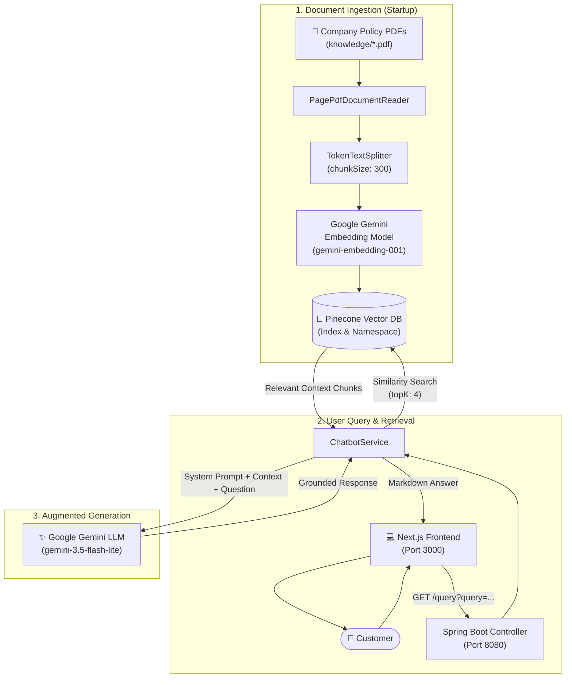

# 🛍️ ShopSphere — E-Commerce AI Support Assistant (RAG)

[](https://openjdk.org/)
[](https://spring.io/projects/spring-boot)
[](https://docs.spring.io/spring-ai/reference/)
[](https://nextjs.org/)
[](https://react.dev/)
[](https://ai.google.dev/)
[](https://www.pinecone.io/)
[](https://tailwindcss.com/)

A full-stack, enterprise-grade **Retrieval-Augmented Generation (RAG)** customer support chatbot for e-commerce platforms. Built with **Spring AI**, **Google Gemini**, **Pinecone Vector Database**, and a modern **Next.js** chat interface.

The assistant automatically indexes company policy documents (shipping, returns, exchanges, refunds, accounts) as embeddings and delivers strictly grounded, hallucination-free answers to customer inquiries in real-time.

---

## 📌 Architecture & RAG Pipeline



---

## ✨ Features

- **Strictly Grounded Answers (Zero Hallucinations):** Strict system prompts prevent false promises by instructing the LLM to reply only from verified store documents.
- **Automated Knowledge Ingestion:** Automatically reads, chunks, embeds, and loads all PDF policies from `classpath:knowledge/*.pdf` on application startup.
- **Semantic Vector Search:** Powered by Pinecone vector storage with Google Gemini embedding generation (`gemini-embedding-001`, 1024 dimensions).
- **High-Performance Chat LLM:** Integrated with Google Gemini Flash (`gemini-3.5-flash-lite`) via official Spring AI starters for rapid responses.
- **Modern Glassmorphic UI:** Next.js dark-themed dashboard featuring:
  - Real-time chat bubbles with Markdown rendering (`react-markdown`).
  - Suggested quick-question shortcuts.
  - Animated typing indicators and smooth auto-scrolling.
  - Responsive layout optimized for desktop, tablet, and mobile.
- **Production-Ready CORS Configuration:** Pre-configured CORS support for seamless local and containerized deployments.

---

## 📂 Project Structure

```text
rag-ecommerce-support/
├── frontend/                               # Next.js Chat Client
│   ├── app/
│   │   ├── globals.css                     # Global styles & animations
│   │   ├── layout.js                       # Root layout & metadata
│   │   └── page.js                         # Chat UI component & state logic
│   ├── public/                             # Static assets
│   ├── next.config.mjs                     # Next.js configuration
│   ├── package.json                        # Dependencies (Next 16, React 19, Tailwind v4)
│   └── README.md
│
├── rag-ecommerce-support/                  # Spring Boot RAG Backend
│   ├── src/
│   │   ├── main/
│   │   │   ├── java/in/strikes/rag_ecommerce_support/
│   │   │   │   ├── RagEcommerceSupportApplication.java
│   │   │   │   ├── config/
│   │   │   │   │   ├── CorsConfig.java     # CORS mappings for frontend
│   │   │   │   │   └── EmbeddingConfig.java# Primary EmbeddingModel bean
│   │   │   │   ├── controller/
│   │   │   │   │   └── ChatbotController.java # REST API endpoint (/query)
│   │   │   │   └── service/
│   │   │   │       └── ChatbotService.java # Ingestion, similarity search & chat completion
│   │   │   └── resources/
│   │   │       ├── application.properties  # App configurations & env bindings
│   │   │       └── knowledge/              # Source policy PDFs
│   │   │           ├── exchange-policy.pdf
│   │   │           ├── orders-account-help.pdf
│   │   │           ├── payment-refund-policy.pdf
│   │   │           ├── return-policy.pdf
│   │   │           └── shipping-delivery.pdf
│   │   └── test/                           # Unit and integration tests
│   ├── .env.example                        # Template for environment variables
│   ├── pom.xml                             # Maven build file (Spring Boot 4.1.1, Spring AI 2.0.1)
│   └── mvnw / mvnw.cmd                     # Maven wrapper executables
│
└── README.md                               # Project documentation (this file)
```

---

## 🛠️ Tech Stack

### Backend
| Technology | Description |
| :--- | :--- |
| **Java 21** | Modern LTS Java runtime |
| **Spring Boot 4.1.1** | Robust backend web framework |
| **Spring AI 2.0.1** | Abstraction layer for AI vector stores, document readers, and models |
| **Google GenAI** | Gemini chat completion (`gemini-3.5-flash-lite`) and text embeddings (`gemini-embedding-001`) |
| **Pinecone** | Managed cloud vector database for semantic similarity matching |
| **Apache PDFBox** | PDF parsing via Spring AI PDF Document Reader |

### Frontend
| Technology | Description |
| :--- | :--- |
| **Next.js 16** | React framework with App Router architecture |
| **React 19** | Declarative component UI library |
| **Tailwind CSS v4** | Utility-first responsive styling and sleek dark mode |
| **React Markdown** | Rich rendering of formatted chatbot responses |

---

## 📋 Prerequisites

Before running the project, ensure you have:

- **Java JDK 21+** installed (`java -version`)
- **Node.js 18.x or 20+** and **npm** installed (`node -v`, `npm -v`)
- A **Pinecone Account** ([Create account](https://www.pinecone.io/)) with an index created
- A **Google AI Studio API Key** ([Get Gemini API key](https://aistudio.google.com/))

---

## 🚀 Getting Started

### 1. Clone the Repository
```bash
git clone https://github.com/ritesh-builds/rag-ecommerce-support.git
cd rag-ecommerce-support
```

---

### 2. Configure Backend Environment Variables

Navigate to the `rag-ecommerce-support` directory and create your `.env` file from the provided `.env.example`:

```bash
cd rag-ecommerce-support
cp .env.example .env
```

Open `.env` and fill in your credentials:

```dotenv
# Pinecone Configuration
PINECONE_API_KEY=your_pinecone_api_key_here
PINECONE_INDEX_NAME=shop-support
PINECONE_NAMESPACE=policies

# Google Gemini Configuration
GEMINI_API_KEY=your_gemini_api_key_here
GEMINI_CHAT_MODEL=gemini-3.5-flash-lite
GEMINI_EMBEDDING_MODEL=gemini-embedding-001
GEMINI_EMBEDDING_DIMENSIONS=1024
```

> [!TIP]
> Ensure your Pinecone index is created with **1024 dimensions** and **cosine** metric to match `gemini-embedding-001`.

---

### 3. Run the Backend

You can run the Spring Boot application using the Maven wrapper:

#### On Windows (PowerShell):
```powershell
# In rag-ecommerce-support/
$env:PINECONE_API_KEY="your_pinecone_api_key"
$env:PINECONE_INDEX_NAME="shop-support"
$env:PINECONE_NAMESPACE="policies"
$env:GEMINI_API_KEY="your_gemini_api_key"
$env:GEMINI_CHAT_MODEL="gemini-3.5-flash-lite"
$env:GEMINI_EMBEDDING_MODEL="gemini-embedding-001"
$env:GEMINI_EMBEDDING_DIMENSIONS="1024"

.\mvnw.cmd spring-boot:run
```

#### On Linux / macOS:
```bash
# In rag-ecommerce-support/
export $(cat .env | xargs)
./mvnw spring-boot:run
```

Once started:
- The backend will scan `src/main/resources/knowledge/*.pdf` and ingest chunks into your Pinecone vector index.
- The server will be listening at **`http://localhost:8080`**.

---

### 4. Run the Frontend

Open a new terminal window, navigate to the `frontend` folder, install dependencies, and start the development server:

```bash
cd frontend
npm install
npm run dev
```

Visit **`http://localhost:3000`** in your browser to interact with the assistant!

---

## 📡 API Reference

### User Query Endpoint

- **URL:** `/query`
- **Method:** `GET`
- **Query Parameters:**
  - `query` *(string, required)*: The customer's support question.

#### Example Request:
```bash
curl -X GET "http://localhost:8080/query?query=What+is+your+return+window%3F"
```

#### Example Response:
```text
You can return any unworn, unwashed item with tags attached within 30 days of the delivery date for a full refund back to your original payment method.
```

---

## 📚 Knowledge Base Documents

The system comes pre-loaded with comprehensive e-commerce policy documents located in `rag-ecommerce-support/src/main/resources/knowledge/`:

1. **`shipping-delivery.pdf`**: Shipping rates, transit timelines, international deliveries, customs, and tracking.
2. **`return-policy.pdf`**: Return eligibility, 30-day window, return shipping labels, and non-refundable items.
3. **`exchange-policy.pdf`**: Size/color exchanges, damaged goods replacements, and warranty claims.
4. **`payment-refund-policy.pdf`**: Accepted payment options, refund processing times, and cancellation policies.
5. **`orders-account-help.pdf`**: Order updates, address changes, account security, and customer service contacts.

To add new documents, simply place any additional `.pdf` file in that folder and restart the backend.

---

## ⚙️ Configuration Reference

| Key | Description | Default / Example |
| :--- | :--- | :--- |
| `PINECONE_API_KEY` | Your Pinecone database API key | `pcsk_...` |
| `PINECONE_INDEX_NAME` | Pinecone index name | `shop-support` |
| `PINECONE_NAMESPACE` | Pinecone namespace partition | `policies` |
| `GEMINI_API_KEY` | Google AI Studio API key | `AIzaSy...` |
| `GEMINI_CHAT_MODEL` | Gemini LLM model identifier | `gemini-3.5-flash-lite` |
| `GEMINI_EMBEDDING_MODEL` | Embedding model identifier | `gemini-embedding-001` |
| `GEMINI_EMBEDDING_DIMENSIONS` | Vector dimension size | `1024` |

---

## 🤝 Contributing

Contributions, issues, and feature requests are welcome!

1. Fork the Project
2. Create your Feature Branch (`git checkout -b feature/AmazingFeature`)
3. Commit your Changes (`git commit -m 'Add some AmazingFeature'`)
4. Push to the Branch (`git push origin feature/AmazingFeature`)
5. Open a Pull Request

---

## 📄 License

Distributed under the MIT License. See `LICENSE` for more information.
